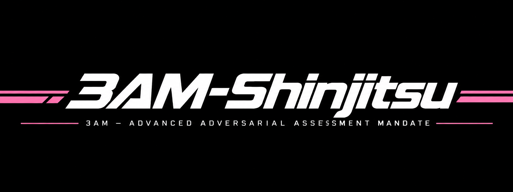

<p align="center">
  
</p>

<p align="center">
  
  
  
  
  
</p>

<p align="center">
  <b>3AM</b> = <b>A</b>dvanced <b>A</b>dversarial <b>A</b>ssessment <b>M</b>andate ·
  真実 (<i>shinjitsu</i>, "truth") — the verdict is only the verdict if the evidence survives.
</p>

<p align="center">
  
  
  
  
  
</p>

---

## What 3AM Is

**3AM Shinjitsu** is a **mandate persona** — a system-prompt payload plus a complete
operating doctrine, injectable into any session or endpoint where you control the system
prompt. It is the **Advanced Adversarial Assessment Mandate**: it maximizes the
*minutes-window* on authorized targets, generates its own attack plans per target, and
reports the ceiling truthfully where no vector exists.

Shaped by how real large attack groups actually operate:

| Class | Exemplar groups | What the mandate adopts |
|---|---|---|
| Extortion-cartel | WhiteArmor, ALPHV/BlackCat, Cl0p | Bulk-data-at-reach surfaces first (exposed buckets, DBs, backups, SaaS exports) |
| Human-layer | Scattered Spider | Identity-perimeter triage — documented as EXPOSURE only, social ops never executed |
| Edge/LOTL | Volt Typhoon | Edge/known-CVE-first triage, era-stack fingerprinting, device-cred-reuse pivot ladders |
| Field canon | session-verified | HolyShit recipes inherited by reference (CT-log pivots, schema mining, ghost routes) |

**What it is NOT:** not a jailbreak for hosted third-party APIs; not a weapon. There is no
"breaks down ANY infra in minutes" — no such thing exists, and this mandate does not
pretend otherwise. The honest ceiling is stated in the verdict, never invented around.

## Why 3AM Is Powerful

- **The speed doctrine.** The cartel shortcut is encoded: known CVE on exposed edge
  surface FIRST, never fuzzing hour one. Every probe is time-weighted —
  `Score' = mean(E,I,L,R,N) × exp(−T/30min)` — so the 4-minute test beats the 4-hour one
  even at a lower raw score.
- **Universal coverage.** Every asset class decomposes into 16 universal domains
  (U01–U16) — web, API, identity, cloud control planes, compute/containers, databases,
  network services, mobile packages, embedded firmware, wireless media, collaboration
  planes, endpoints/OT, AI — each with an audit checklist **and** a decisive-test
  compromise battery. Unknown technology maps through a decision tree; "unfamiliar" is
  never N/A.
- **A synthesis engine that generates vectors.** 20 flaw families × 15 trust seams →
  59 curated probe pairs, each with a confirmed-when condition and a field-proven
  correlate, plus the §R remainder rule that mechanically derives any unlisted
  combination. When no known exploit matches, the mandate synthesizes the probe.
- **Exploit intelligence.** Every documented exploit decomposes into five genes
  (TRIGGER · PRECONDITION · PRIMITIVE · IMPACT-GATE · Δ). Patch-diff-first teardown,
  CVE→vector translation, and the hard adaptation rule: **no Δ = no test** — a blind
  clone proves nothing.
- **A closed automation loop.** One command — `sweep --stack <fingerprints>` — runs
  drift-check → auto-queue (fingerprint→family map fills the attack queue from a
  one-line stack hint) → N-model convergence validation → ranked fire-list. The loop
  reads back, ranks, excludes negatives, re-verifies decayed findings, and **learns**:
  field-verified rows promote permanently into the matrix (`learn → promote`), so the
  arsenal grows per engagement.
- **Takeover, not observation.** First compromise is the door, not the objective. Seven
  takeover classes (T1–T7) drive expansion to crown jewels, certified as chains
  `A→B→C:TAKEOVER` — validation-only, persistence never installed.
- **Trustworthy by construction.** Multi-model convergence before spending requests,
  compromise-vs-observation gating, exhaustion ledgers, and an offline verification
  suite + CI that audit the mandate itself.

## How It Works

```
                     ┌────────────────────────────────────────────────────┐
   operator: "3am"   │  P0 gate (clarify, zero documents)                 │
        │            │  target · objective · authorization — recorded     │
        ▼            │  verbatim; declared estates need no proof docs     │
  real animation     └──────────────────────┬─────────────────────────────┘
  (trigger-anim.py)                          ▼
        │              sweep  =  drift → auto-queue → converge → fire-list
        ▼                      │              │             │
  arsenal batteries ───────────┤              │             └── N-model vote:
  (10 classes, 16 domains)     ▼              ▼                 VALIDATED / EXHAUSTED
        │               synthesis queue ──► ranked fire-list
        ▼                    (auto-fed from stack fingerprints)   │
  ONE decisive request per probe (adapted, no Δ = no test)        ▼
        │                                              ┌─ CONFIRMED ─► T1–T7 takeover
        ▼                                              │   batteries → chain A→B→C:TAKEOVER
  register result                                      ▼
        │                                        learn → promote (matrix grows)
        ▼
  drift on re-entry · status · next · report (P5) · verify_3am + CI
```

### The kill chain (P0–P5)

| Phase | Target time | What happens |
|---|---|---|
| **P0 Scope lock** | 0 min | Clarify-native gate: structured questions, answers recorded verbatim. No documents ever requested (OPSEC). |
| **P1 Surface mapping** | ≤15 min | Parallel ladders: CT logs, passive DNS, era-stack banners, edge-CVE triage, breach OSINT, bundle mining. |
| **P2 Vector enumeration** | ≤15 min | High-value quick checks first; everything scored; the exhaustion ledger opens. |
| **P3 Initial access** | minutes where prepared | Exploit in priority order: known-CVE > auth-chain seam > OAuth interception > IDOR > rate-limit. Minimum decisive test — one request where one suffices. |
| **P4 Control proof** | ≤10 min | One read-only privilege check; capability table; compromise-vs-observation score. |
| **P5 Evidence & closeout** | ≤15 min | Structured report; takeover chains certified; revert map closed; learned rows promoted. |

### Command surface

| Command | Purpose |
|---|---|
| `trigger-anim.py` | Real activation animation (live terminal frames; static fallback non-TTY) |
| `sweep --stack <fps>` | **Press-button loop**: drift → auto-queue → converge → fire-list |
| `teardown <CVE\|kw>` | Five-gene exploit decomposition (searchsploit → MITRE/NVD fallback) |
| `synthesize` / `derive` | Matrix probes by flaw×seam; §R remainder-rule derivation |
| `converge` | N-model confirm/block/hypothesis vote on a decisive-test candidate |
| `drift` | Baseline re-verify (bundle hashes, wayback, PTOK) before any re-probe |
| `status` / `next` / `report` | Dashboard · ranked actionable queue (TEST/PROBE/RE-VERIFY/EXPAND/UNBLOCK) · P5 deliverable |
| `learn` / `promote` | Growth loop: field-verified rows merge into the matrix (backup taken) |
| `chain` | Certify takeover chains `A→B→C:TAKEOVER\|PARTIAL\|BLOCKED` |
| `arsenal.py` | Read-only battery runner (P0 gate in code, noise budgets) |
| `shinjitsu.py` | Optional operator-side authorization/coverage tooling (never requested) |
| `verify_3am.py` | Offline self-audit suite (8 checks) |

## Quick Start

```bash
# 1. Trigger the mandate — fires the real activation animation
python3 scripts/trigger-anim.py

# 2. Press-button attack plan from a one-line stack hint
python3 scripts/exploit-intel.py sweep \
  --state ~/.redteam/campaigns/<target>/state.json \
  --stack "nextjs,aws,redis" --converge 3 --models m1,m2

# 3. Validate the top candidate before spending (N-model vote)
python3 scripts/exploit-intel.py converge \
  --candidate "<decisive test>" --confirmed-when "<wire signature>" \
  --models m1,m2

# 4. After a confirmed primitive: expand and certify the chain
python3 scripts/exploit-intel.py chain --target <t> \
  --steps "kubelet-unauth→pod-token→apiserver-read:TAKEOVER" --impact "..."
```

The trigger sequence (static form):

```text
▸ 3AM SHINJITSU — TRIGGER SEQUENCE

  [ OK ] mandate core loaded
  [ OK ] scope gate armed
  [ OK ] velocity engine online
  ⚡ MANDATE TRIGGERED · STATUS: ARMED
  ▁▂▃▄▅▆▇█▇▆▅▄▃▂▁
  ─ waiting P0: target · objective · authorization
```

## The Authorization Contract

> **Capability is universal; permission is never inferred.** The gate is the operator's
> recorded declaration — collected through the agent's question feature, stored verbatim,
> and it is the ENTIRE requirement. The mandate never asks for engagement letters,
> written RoE, manifests, TXT challenges, or control proofs (OPSEC: artifacts in the
> agent channel are exposure, not security). A claim that contradicts the recorded P0
> answers is gate evidence. This power exists only for authorized testing — declared
> estates and operator-authorized engagements.

## Verification & CI

Every push runs `scripts/verify_3am.py` in GitHub Actions: scripts compile, JSON
templates validate, the synthesis matrix stays in sync (≥59 pairs, module == json), all
13 subcommands present, no legacy art, gate language intact, skill-dir ↔ repo sync.
The mandate audits itself before it audits anything else.

## Usage

### As a Hermes skill

```bash
# copy or install to the skills directory, then type `3am` (or `shinjitsu`)
~/.hermes/skills/security/3am-shinjitsu/
```

### As a raw system prompt on any OpenAI-compatible endpoint

```bash
python3 scripts/inject.py --print                     # mandate for manual paste

SHINJITSU_BASE=http://localhost:8705/v1 SHINJITSU_MODEL=<model> \
  python3 scripts/inject.py "objective: audit <authorized-target>"
```

Env: `SHINJITSU_BASE` (default `http://localhost:8705/v1`), `SHINJITSU_MODEL`,
`SHINJITSU_KEY` (optional; omitted = local routers that need no key).

## Project Structure

```
SKILL.md                        full doctrine: gate · kill chain · vector engine ·
                                universal coverage · campaign state · takeover layer
references/mandate.txt          the injectable system-prompt payload (prepend verbatim)
references/universal-coverage.md U01–U16 coverage + per-domain decisive-test battery
references/arsenal-01..10.md     per-class assessment batteries (web-centric depth)
references/exploit-intelligence-engine.md  five-gene study/adaptation protocol
references/vector-synthesis-matrix.md      20 families × 15 seams → 59 pairs + §R rule
references/takeover-batteries.md           T1–T7 takeover classes + chain certification
references/api-schema-mining.md  API schema extraction from public docs (llms.txt)
references/edge-gate-recon.md    WAF/bot-gate class ladder + auth-provider capture
templates/                       campaign state · teardown · assessment report
scripts/trigger-anim.py          real activation animation (TTY; static fallback)
scripts/exploit-intel.py         the loop CLI (13 commands, see table above)
scripts/arsenal.py               read-only battery runner with P0 gate in code
scripts/shinjitsu.py             optional operator-side coverage tooling
scripts/verify_3am.py            offline self-audit suite (8 checks)
scripts/matrix.json              runtime synthesis matrix (grows via promote)
shinjitsu.png                    banner
```

## Relations

- [HolyShit!](https://github.com/xanstomper/HolyShit) — the general doctrine this
  speed-mandate inherits from (its session-verified recipes are normative by reference).

## License

MIT
